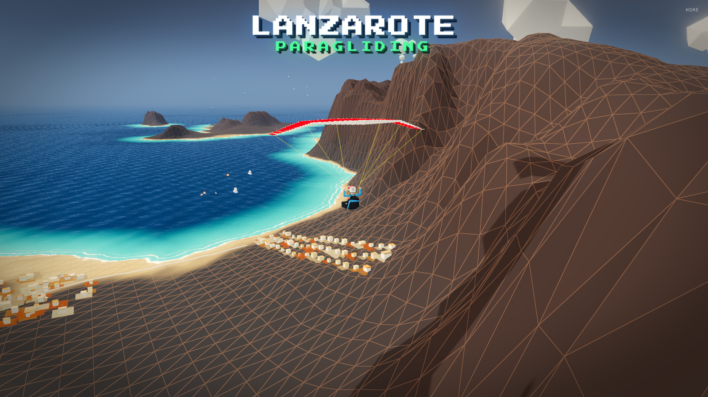
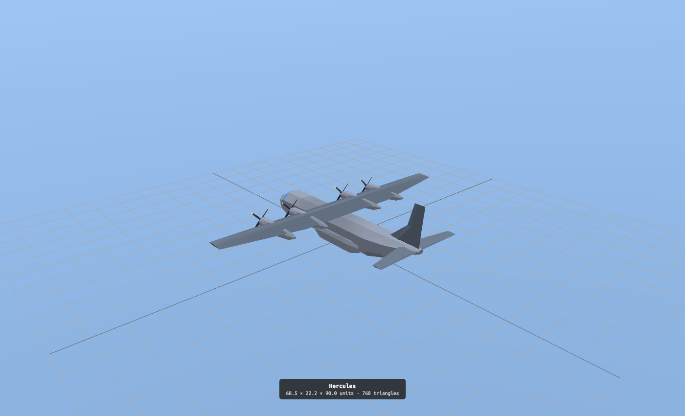
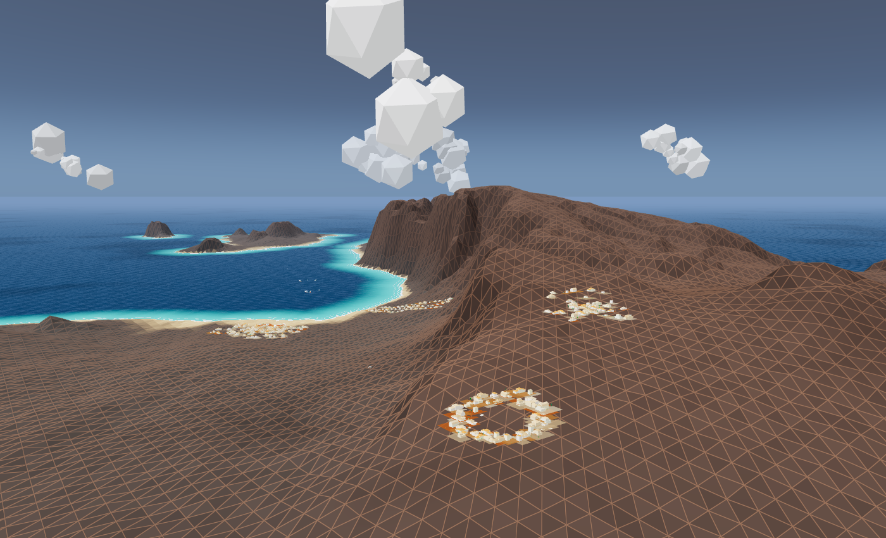
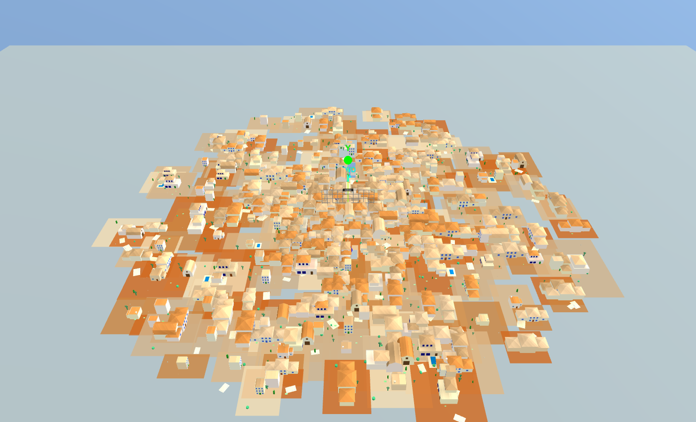
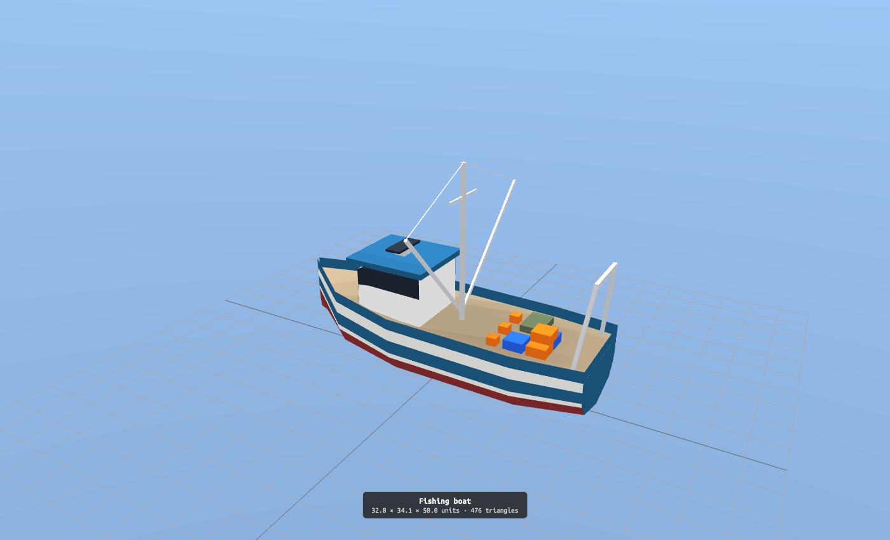

# Lanzarote 3D

[](https://github.com/iloire/lanzarote3d/actions/workflows/ci.yml)

A low-poly Lanzarote in the browser: paragliders ridge-soar the Famara cliffs over a real height
map, with a living sea, gulls, towns, boats and planes.



|                                                                                         |                                                                                              |
| --------------------------------------------------------------------------------------- | -------------------------------------------------------------------------------------------- |
|  |  |
| **Hercules:** one of the planes crossing the sky                                        | **Famara static:** the landscape on its own                                                  |
|        |              |
| **Town:** a generated town up close                                                     | **Models:** every model on a turntable                                                       |

Built with three.js, React and webpack. How a frame is drawn (the filmic pipeline, the sea, the
shaded wireframe, adaptive quality) is in [docs/RENDERING.md](docs/RENDERING.md); the rest of the
docs are indexed in [docs/README.md](docs/README.md).

## Running it

```bash
npm install
npm run dev        # webpack dev server on http://localhost:8080, opens the home scene
```

The same repo builds a second site, **relax**: pick a paragliding place (Lanzarote, Tenerife, El
Hierro, Rio de Janeiro, Castejón de Sos) and watch a few gliders soar its ridge, or New York, where
paramotors fly the street canyons of a voxel Midtown. It has its own build, so the Lanzarote site
never ships it:

```bash
npm run start:relax   # dev server, opens the relax scene
npm run build:relax   # production build into dist-relax/
```

Each app in `src/config/apps.json` belongs to one site (`"site": "relax"`, Lanzarote otherwise).
New places are described in [`src/locations/README.md`](src/locations/README.md). The relax site
has no deploy script yet; it gets one with its domain.

Scenes are picked with `?story=`: `home`, `famara-animation`, `boats-animation`, `famara`,
`town` and `models`. Add `?fx=0` to render without post-processing, to
compare looks and frame times. Dev builds expose `window.__lz` for profiling (see RENDERING.md).

## Checking it

```bash
npm run lint:check
npm run format:check
npm run type-check
npm run test:ci    # Jest
```

`npm run format` rewrites files into the Prettier style that `format:check` expects.

GitHub Actions (`.github/workflows/ci.yml`) runs Jest, then all three checks and the production
build of both sites, on every push to `master` and every pull request.

## Deploying

Production is [3d.lanzaroteparagliding.com](https://3d.lanzaroteparagliding.com): an S3 bucket
(`lanzaroteparagliding-placeholder`) behind CloudFront, deployed with the AWS CLI's
`lanzaroteparagliding` profile. The lanzaroteparagliding.com landing page embeds the home scene with
`?embed=1`, which hides the title overlay.

```bash
brew install awscli                                  # once
aws configure --profile lanzaroteparagliding         # once: access key, secret, region
aws s3 ls --profile lanzaroteparagliding             # check the profile works

npm run deploy-prod
```

`deploy-prod` builds the Lanzarote site into `dist/` (never the relax site), tags the commit `PROD-<date>_<time>` (locally), empties the
bucket, uploads `dist/` and invalidates the CloudFront cache. Two things to know:

- It builds the **working tree**, uncommitted changes included. Deploy from a clean checkout of
  `master` to ship exactly what's committed.
- The bucket is **empty for the length of the upload**, so the site can briefly 404.

`npm run run-prod` builds and serves `dist/` locally on port 8080, to check a production build
before deploying.

## Development notes

### Dev mode: every scene in the menu

Production menus list only the public scenes, and the home scene hides its sidebar. Dev mode lists
the private scenes too (`famara`, `town`, `models`) and shows the sidebar everywhere.

- **Turn on:** open any page with `?dev=1`, e.g. `https://3d.lanzaroteparagliding.com/?dev=1`
- **Turn off:** `?dev=0`

It sticks in this browser (`localStorage.lanzarote_dev_mode`) until turned off, and the console logs
"🔓 Dev mode enabled" on load. These do the same from the browser console, followed by a reload; run
them on the scene's own page, not on a page that embeds it in an iframe:

```js
enableDevMode();
disableDevMode();
```

To show the sidebar on home without listing private scenes, run this in the console and reload:

```js
localStorage.setItem('lanzarote_show_menu', 'true');
// to undo:
localStorage.removeItem('lanzarote_show_menu');
```

At `localhost` the private scenes are always listed; home still hides its sidebar unless `?dev=1`.
Private scenes also open directly without dev mode: `?story=famara`, `?story=town`.

### Model viewer

`?story=models` (Models in the dev menu) shows every model the scenes use, one at a time on a
turntable, with its size and triangle count: pick one from the list, step with ← / →, space toggles
the spin, `?model=<id>` links to one. A new model goes in `src/applications/models/catalog.ts`.

## Source art

`3d/` holds the island's sources: the height map (`.xcf` / `.png`) and a Blender scene of the island (`lanzarote.blend`). The scenes load `assets/foundation/models/environment/lanzarote.glb`. After exporting it from Blender, run `python3 3d/slim-glb.py <exported.glb> assets/foundation/models/environment/lanzarote.glb`: it welds the points and drops the normals and UVs the scenes don't use (8.3 MB → 1.3 MB). The pilots are voxel models from the `3d-characters` repo, exported to `.obj`.

## Credits / inspiration

- [https://github.com/dragonir/3d](https://github.com/dragonir/3d)
